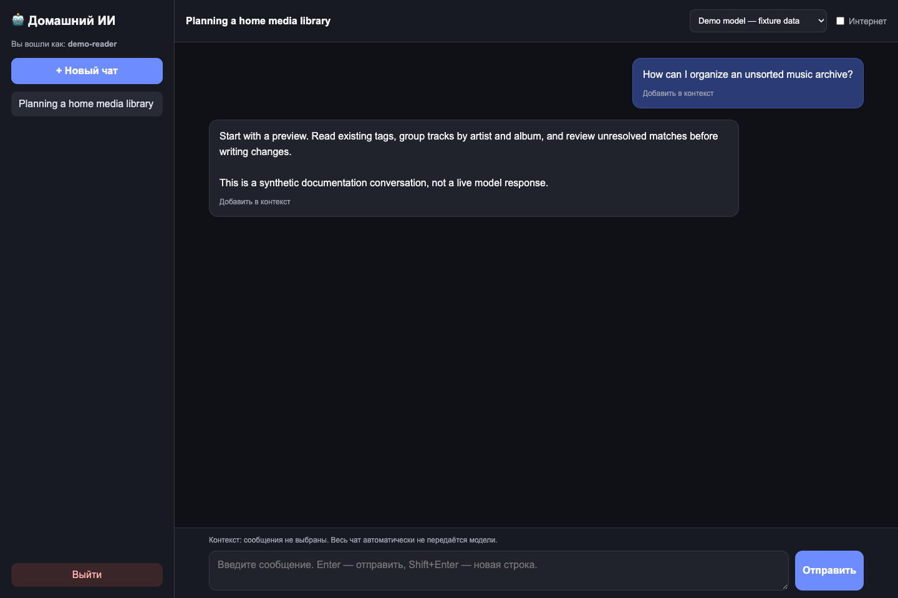

# Ollama Queue WebUI

**English** | [Русский](README.ru.md)

[](https://github.com/ginginohf/ollama-queue-webui/actions/workflows/tests.yml) [MIT](LICENSE)

A self-hosted multi-user chat frontend for Ollama with persistent conversations and a sequential generation queue, useful when several people share one inference machine.

## What it does

- Provides registration/login, individual chat lists and persisted messages.
- Lists configured models and lets the user choose a model for generation.
- Queues generation work in one application process instead of launching every request simultaneously.
- Lets the browser track task progress and recover an active task after a page reload.
- Supports selecting message context and optional web search through SearXNG.
- Keeps application state in SQLite; Ollama and its downloaded models remain separate services.

## Examples and screenshots

See [worked examples](docs/EXAMPLES.md) for reproducible demonstrations and output. Examples use synthetic data; no private server configuration is included.



## Requirements

Python 3.11+ with OpenSSL, dependencies in requirements.txt, Ollama with an installed model; optional SearXNG.

## Quick start

```sh
git clone https://github.com/ginginohf/ollama-queue-webui.git
cd ollama-queue-webui
python3 -m venv .venv
. .venv/bin/activate
pip install -r requirements.txt
cp .env.example .env
python3 -c "import secrets; print(secrets.token_hex(32))"
# Put the generated SECRET_KEY in .env; set OLLAMA_URL and OLLAMA_MODEL.
gunicorn --workers 1 --threads 8 --bind 127.0.0.1:5000 --timeout 120 server:app
```

## Configuration and limits

Run exactly one Gunicorn worker: the queue is in process memory and is not a distributed durable queue. A process restart does not guarantee continuation of queued work. Ollama must be reachable from the application/container. Set strong secrets; enable secure cookies behind HTTPS and trust forwarded headers only behind a trusted proxy. The UI currently uses Russian labels. Demo screenshots use fixture responses, not a live model generation.

`AI_DATA_DIR` selects persistent storage. An empty `INTERNAL_API_KEY` disables the internal endpoint. Set `SESSION_COOKIE_SECURE=true` for HTTPS and `TRUST_PROXY=1` only behind your trusted proxy. See `.env.example` for the full application configuration.

## Tests

```sh
python3 -m unittest discover -s tests -v
```

Install dependencies first when `requirements.txt` is present. See [TESTING.md](TESTING.md) for scope and limitations.

## Documentation

- [Examples](docs/EXAMPLES.md)
- [Recovery and upgrades](RESTORE.md)
- [Security](SECURITY.md)
- [Contributing](CONTRIBUTING.md)
- [Third-party components](THIRD_PARTY.md)

## License

Original project code is available under the [MIT License](LICENSE). Third-party components retain their own licenses.
