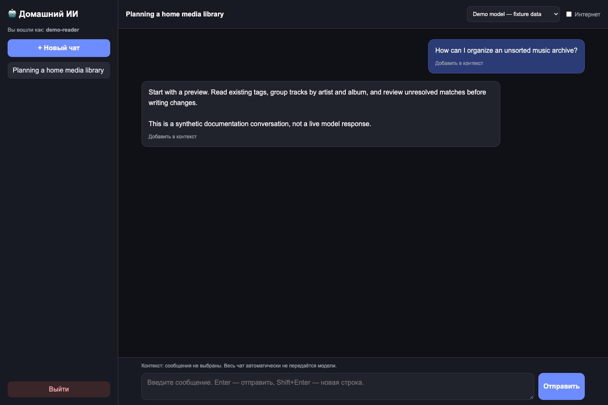

# Веб-интерфейс Ollama с очередью

[English](README.md) | **Русский**

[](https://github.com/ginginohf/ollama-queue-webui/actions/workflows/tests.yml) · [MIT](LICENSE)

Чаты, пользователи, сессии, последовательная очередь генераций и необязательный поиск через SearXNG. Внешние персональные утилиты анализа диалогов исключены.

Редакция 0.1.0 под лицензией MIT. Не содержит настроек конкретного сервера и пользовательских данных. Это самостоятельная адаптация, а не побитная копия рабочего развёртывания.

## Что делает проект

Веб-чат для общего сервера Ollama: пользователи, личные чаты, история сообщений, выбор модели и последовательная очередь генераций. Браузер следит за задачей и может восстановить отображение после обновления страницы. Есть выбор контекста и необязательный поиск SearXNG. История хранится в SQLite; модели устанавливаются отдельно в Ollama. Нужен один worker: очередь в памяти процесса, её сохранение при перезапуске не гарантируется. Примеры используют тестовые ответы, а не реальную генерацию модели.

## Примеры

[Запуск, вывод и демонстрации](docs/EXAMPLES.ru.md).



## Требования

Python 3.11+ с OpenSSL, Ollama с заранее загруженной моделью; SearXNG для поиска.

## Развёртывание

Скачайте проект:

```sh
git clone https://github.com/ginginohf/ollama-queue-webui.git
cd ollama-queue-webui
```

Следующие команды выполняются из корня репозитория. Не используйте production-данные для первого запуска.

```sh
python3 -m venv .venv
. .venv/bin/activate
pip install -r requirements.txt
cp .env.example .env
python3 -c "import secrets; print(secrets.token_hex(32))"
# Запишите результат как SECRET_KEY в .env. Настройте OLLAMA_URL/OLLAMA_MODEL.
gunicorn --workers 1 --threads 8 --bind 127.0.0.1:5000 --timeout 120 server:app
```

## Настройки и ограничения

Обязательно один worker: очередь в памяти процесса, несколько процессов создадут независимые очереди. Данные в instance/ либо AI_DATA_DIR; для бэкапа остановить процесс или применять SQLite backup API. INTERNAL_API_KEY пустой — внутренний endpoint отключён. MINECRAFT_API_KEY — необязательная интеграция. SESSION_COOKIE_SECURE=false только локальный HTTP; за HTTPS установите true. TRUST_PROXY=1 только за единственным доверенным прокси. Для Docker OLLAMA_URL должен указывать доступный из контейнера адрес, а не его127.0.0.1. Нет модели/сервиса Ollama — генерация не работает; это не поставщик модели.

## Проверки

```sh
python3 -m unittest discover -s tests -v
```

Для проектов с requirements.txt сначала установите зависимости в виртуальное окружение. Результаты локальных проверок и ограничения — в TESTING.md. CI предназначен для Linux; аппаратные счётчики и реальные диски в CI не эмулируются.

## Обновление и откат

Сохраните конфигурацию и данные отдельно от кода. Остановите только этот экземпляр, замените код, выполните тесты, запустите снова. Не переносите тестовые базы поверх рабочих. Подробности — RESTORE.md.

## Приватность и публикация

.env/config.json, базы, журналы, state и зависимости исключены из Git. Игнорирование не очищает уже закоммиченные данные: перед push повторите аудит. README-примеры не содержат действующих учётных данных. См. SECURITY.md, CONTRIBUTING.md, THIRD_PARTY.md. Собственный код распространяется по [MIT](LICENSE). Сторонние компоненты сохраняют свои условия.

## Документация и обратная связь

- [Проверки и их ограничения](TESTING.ru.md)
- [Обновление и восстановление](RESTORE.ru.md)
- [Безопасность и секреты](SECURITY.ru.md)
- [Как предложить изменение](CONTRIBUTING.ru.md)
- [Сторонние компоненты](THIRD_PARTY.ru.md)

Сообщая об ошибке через Issues, укажите версию ОС, команду запуска и ожидаемый результат. Удалите из журналов токены, пароли и личные данные.
