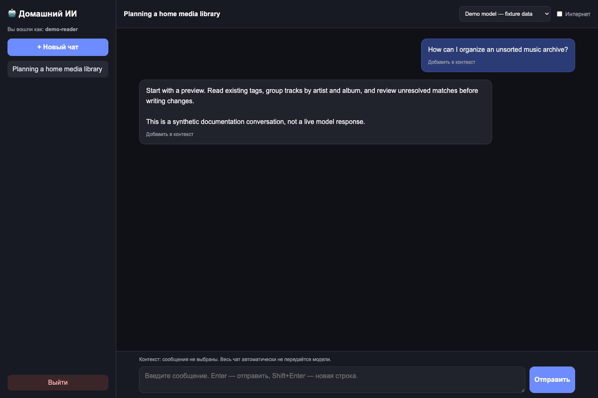

# Визуальные примеры

[English](EXAMPLES.md) | [О проекте](../README.ru.md)

Настоящий интерфейс чата с тестовыми ответами API: пользователь, модель и диалог. Это не реальная генерация и не тест скорости модели.



## Как воспроизвести

Отдельное тестовое окружение; скрипт перехватывает запросы и блокирует внешнюю сеть. Рабочий сервер не нужен. Интерфейс не перерисован вручную.

```sh
python3 -m venv /tmp/ui-capture-venv
. /tmp/ui-capture-venv/bin/activate
pip install playwright
playwright install chromium
python3 examples/capture_ui.py
```

Файлы сохраняются в `docs/images/`. Для установленного Chrome можно задать `DEMO_CHROME` вместо скачивания Chromium. Подписи интерфейса сейчас русские; язык документации не меняет язык приложения.
